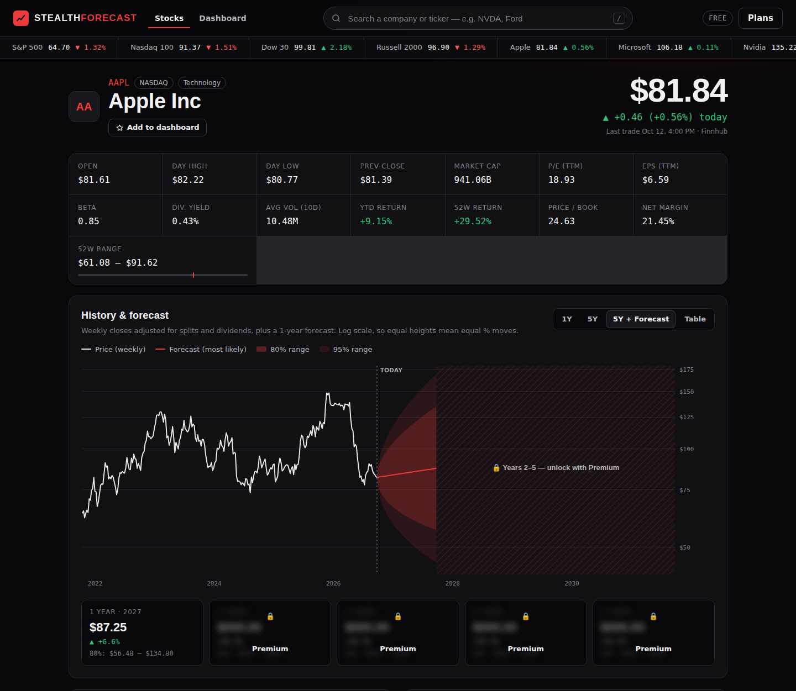
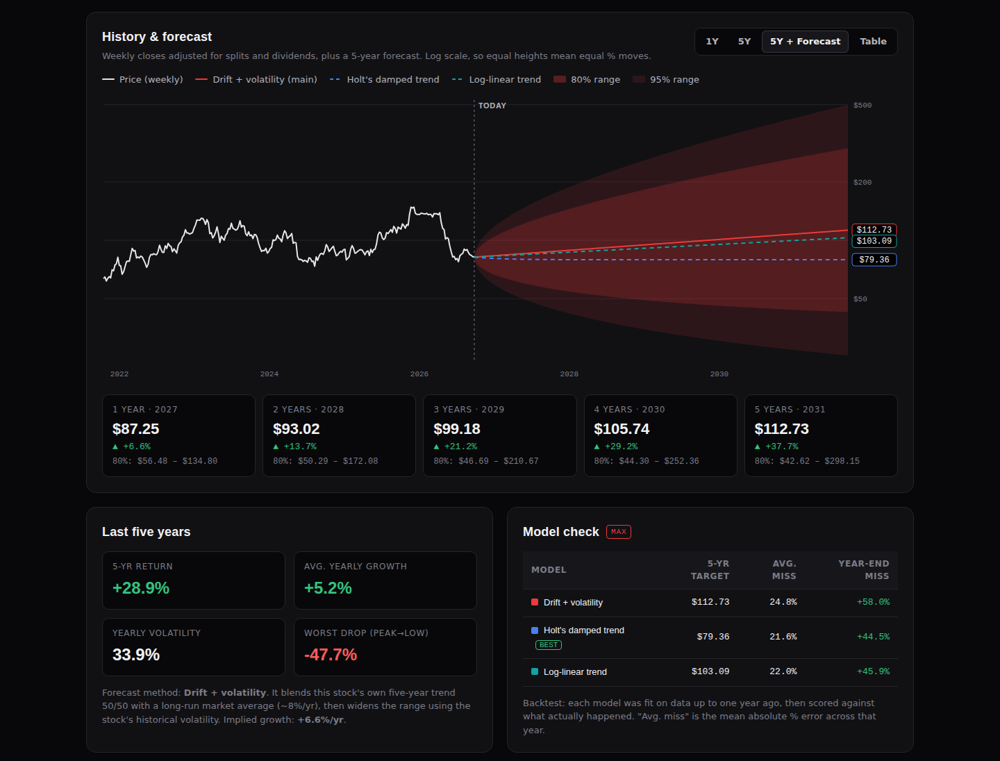
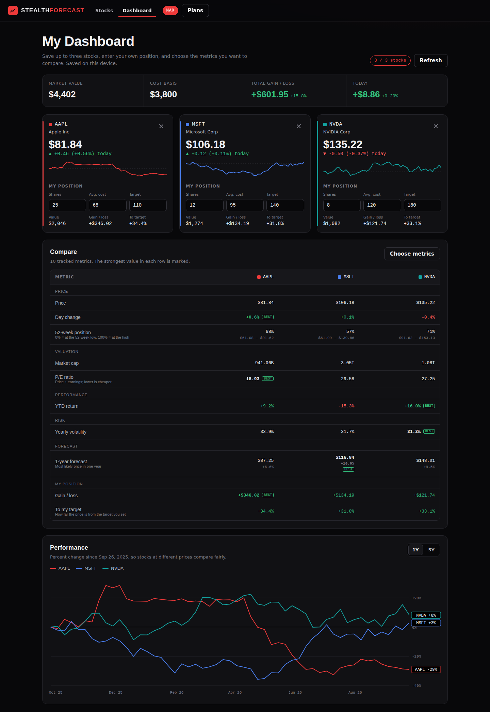
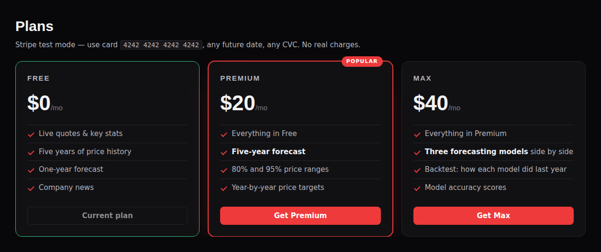
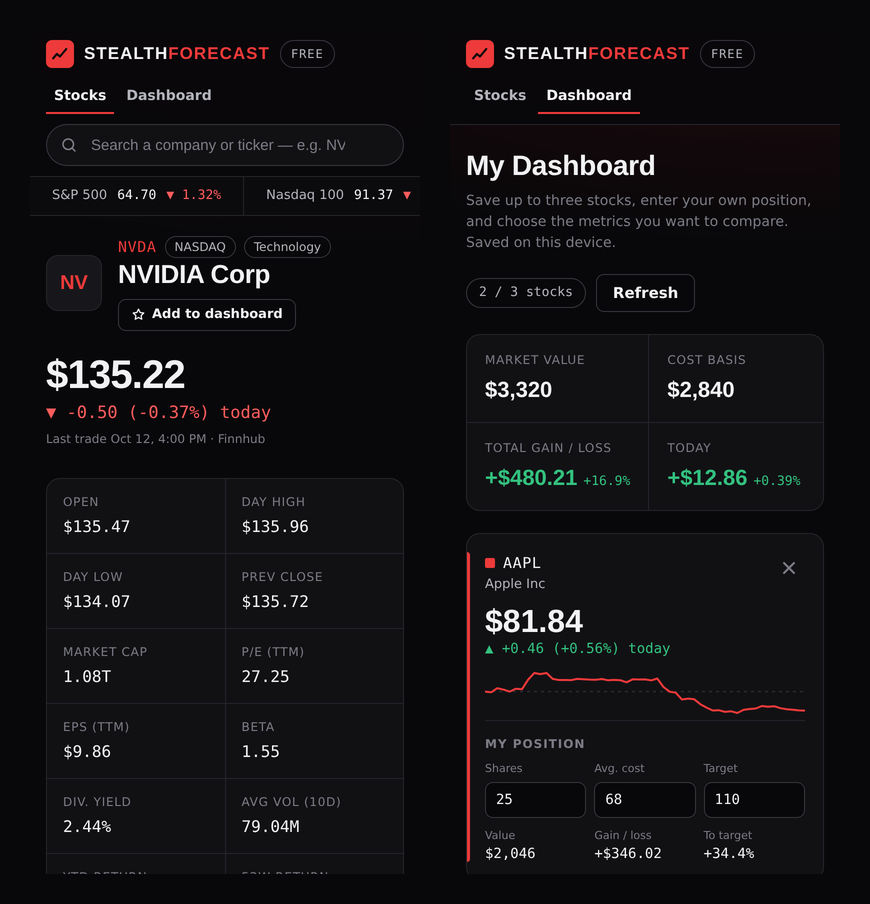

# Stealth Forecast

Stock dashboard with five years of price history and a five-year forecast. Red and black theme, no build step, no npm dependencies.

## Screenshots

> Captured from a local run with **sample data** (prices, metrics and headlines are illustrative, not real market data).

**Stock page.** Live quote, key stats and five years of weekly history with a forecast. The Free plan shows one year; years 2 to 5 unlock with Premium.



**Max plan.** Five-year forecast with 80%/95% ranges, three models side by side, yearly targets and a one-year backtest.



**Dashboard.** Up to three saved stocks with your own position, portfolio totals, your chosen metrics compared side by side, and indexed performance.



**Plans.** Stripe Checkout in test mode.



**Mobile.**



## Setup (Vercel → Project → Settings → Environment Variables)

| Variable | Where to get it |
|---|---|
| `FINNHUB_API_KEY` | finnhub.io dashboard (free plan works) |
| `ALPHAVANTAGE_API_KEY` | alphavantage.co/support/#api-key (free) |
| `STRIPE_SECRET_KEY` | Stripe dashboard → Developers → API keys, **test mode** `sk_test_…` key for the "FinTech Demo Class sandbox" |

Optional: `PLAN_SECRET` (signs the plan cookie; defaults to a hash of the Stripe key), `STRIPE_PRICE_PREMIUM`, `STRIPE_PRICE_MAX` (default to the sandbox prices created for this app).

Redeploy after adding variables.

## Data sources
- **Finnhub**: live quote, profile, key metrics, news, symbol search, ticker strip.
- **Alpha Vantage**: weekly split/dividend-adjusted closes (`TIME_SERIES_WEEKLY_ADJUSTED`). The free key allows about 25 calls/day, so `/api/history` is cached at Vercel's CDN for 12 hours per symbol.
  Finnhub's free plan does not include historical candles, which is why history comes from Alpha Vantage.

## Plans (Stripe test mode)
| Plan | Price | Unlocks |
|---|---|---|
| FREE | $0 | quotes, stats, 5-yr history, 1-yr forecast |
| PREMIUM | $20/mo | 5-yr forecast with 80%/95% ranges and yearly targets |
| MAX | $40/mo | + three-model comparison and one-year backtest accuracy |

Checkout uses Stripe Checkout. After payment, `/api/verify` confirms the session with Stripe and stores the plan in a signed, HttpOnly cookie. "Downgrade to Free" cancels the test subscription. Test card: `4242 4242 4242 4242`.

## Dashboard (`/dashboard`)
- Save up to **3 stocks** from the search on the dashboard or the **Add to dashboard** button on any stock page. Each stock keeps its color while it is saved.
- **My position** per stock: shares, average cost and target price → market value, gain/loss and distance to target, plus portfolio totals (market value, cost basis, total gain/loss, today's change).
- **Choose metrics**: 26 metrics across Price, Valuation, Performance, Risk, Fundamentals, Forecast and My position. The comparison table marks the strongest value in each row; the 5-year forecast metric needs Premium.
- **Performance chart**: percent change over 1Y or 5Y, so stocks at different prices compare fairly.
- Saved stocks, positions and metric choices live in the browser's localStorage (no accounts in this demo), so they are per device and never sent to the server.

## Forecast method
Weekly log prices. Main model: drift + volatility, where drift is the stock's own 5-yr average blended 50/50 with an ~8%/yr market prior, and ranges widen with √time using historical volatility. MAX adds Holt's damped trend and a log-linear trend, each backtested on the most recent year.

Not investment advice: forecasts are statistical ranges, not predictions.

## Files
- `index.html`, `styles.css`, `app.js`: stock page
- `dashboard.html`, `dashboard.css`, `dashboard.js`: dashboard · `store.js`: saved dashboard state · `util.js`: shared helpers
- `vercel.json`: clean URLs (`/dashboard`)
- `api/*.js`: Vercel functions (`stock`, `search`, `news`, `market`, `history`, `forecast`, `checkout`, `verify`, `plan`)
- `lib/forecast.js`: forecasting engine · `lib/history.js`: Alpha Vantage · `lib/server.js`: helpers, Stripe REST, signed plan cookie

## Reproduce this app

Everything runs on free tiers: the app has no npm dependencies and no build step. It's static HTML/CSS/JS plus a few Vercel serverless functions in `api/`.

### 1. What you need

| Account | Used for | Cost |
|---|---|---|
| [GitHub](https://github.com) | your copy of the code | free |
| [Vercel](https://vercel.com) | hosting the site and the `api/` functions | free (Hobby) |
| [Finnhub](https://finnhub.io/register) | live quotes, company profile, key metrics, news, search | free API key |
| [Alpha Vantage](https://www.alphavantage.co/support/#api-key) | five years of weekly price history | free API key (about 25 requests/day) |
| [Stripe](https://dashboard.stripe.com/register) | Premium/Max checkout, **test mode only** | free |

For local development you also need [Node.js](https://nodejs.org) 18 or newer and the Vercel CLI (`npm i -g vercel`).

### 2. Get the code

Fork this repository on GitHub, or clone it:

```bash
git clone https://github.com/Tua-Absolute/Forecasting-App-FinTech.git
cd Forecasting-App-FinTech
```

### 3. Create the two paid plans in Stripe (test mode)

1. In the Stripe Dashboard, switch on **Test mode** (or use a sandbox).
2. Go to **Product catalog → Add product** and create:
   - **Stealth Forecast Premium**: recurring, **$20.00 / month**
   - **Stealth Forecast Max**: recurring, **$40.00 / month**
3. Open each product and copy its **price ID** (starts with `price_`).
4. Go to **Developers → API keys** and copy the **Secret key** (starts with `sk_test_`). The app refuses live keys.

The Free plan needs nothing in Stripe.

### 4. Deploy to Vercel

1. In Vercel, choose **Add New → Project** and import your fork.
2. Leave **Framework Preset** as **Other**. There is no build command and no output directory. Vercel serves the HTML files and turns each file in `api/` into a function.
3. Under **Environment Variables**, add:

| Variable | Value | Required |
|---|---|---|
| `FINNHUB_API_KEY` | your Finnhub key | yes |
| `ALPHAVANTAGE_API_KEY` | your Alpha Vantage key | yes |
| `STRIPE_SECRET_KEY` | your `sk_test_…` key | yes |
| `STRIPE_PRICE_PREMIUM` | the $20/month price ID | **yes**: the built-in default belongs to the original author's Stripe sandbox and won't work with your key |
| `STRIPE_PRICE_MAX` | the $40/month price ID | **yes**, same reason |
| `PLAN_SECRET` | any long random string | recommended; signs the plan cookie (falls back to a hash of the Stripe key) |

4. Click **Deploy**. When it finishes, open the URL and search a ticker such as `AAPL`. The dashboard is at `/dashboard`.

> Environment variable changes only apply to new deployments. If you add or change one later, redeploy from the **Deployments** tab.

New Vercel projects have **Vercel Authentication** turned on, so only you can open the site while you're logged in. To share it, turn that off under **Settings → Deployment Protection**.

### 5. Run it locally (optional)

```bash
vercel link        # connect the folder to your Vercel project
vercel env pull    # writes your environment variables to .env.local (ignored by git)
vercel dev         # serves the site and api/ at http://localhost:3000
```

Or create `.env.local` by hand with the variables from the table above, then run `vercel dev`.

### 6. Check that it works

| Check | What you should see |
|---|---|
| Open `/?s=AAPL` | live price, stats grid, five-year chart with a one-year forecast |
| Search "ford" | `F` in the suggestions; selecting it switches the page |
| **Plans → Get Premium**, pay with `4242 4242 4242 4242`, any future date, any CVC | redirect back with "Payment confirmed" and the five-year forecast unlocked |
| **Add to dashboard** on two stocks, then open `/dashboard` | both cards, the comparison table and the performance chart |

### Troubleshooting

| Symptom | Cause and fix |
|---|---|
| A panel says "`FINNHUB_API_KEY` is not set" (or another variable) | Add the variable in Vercel, then redeploy. |
| "Alpha Vantage's free daily limit… has been reached" | The free key allows about 25 history lookups per day. Each symbol's history is cached for 12 hours, so charts already viewed still load. New symbols work again the next day. |
| Checkout says "No such price" | `STRIPE_PRICE_PREMIUM` / `STRIPE_PRICE_MAX` aren't set to price IDs from **your** Stripe account in test mode. |
| "This demo only runs with a Stripe test-mode key" | Use the `sk_test_…` key, not `sk_live_…`. |
| `/dashboard` returns 404 or a push doesn't show up | The latest commit wasn't deployed. Check **Deployments** in Vercel, or use **Create Deployment** from `main`. For automatic deploys, make sure Vercel's GitHub app has access to your fork (GitHub → Settings → Applications → Vercel). |
| "No live quote found" | Finnhub's free plan covers US-listed stocks only. |
